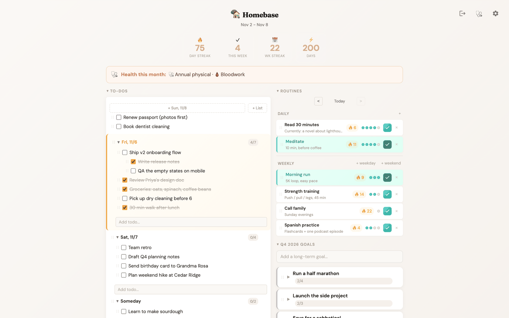
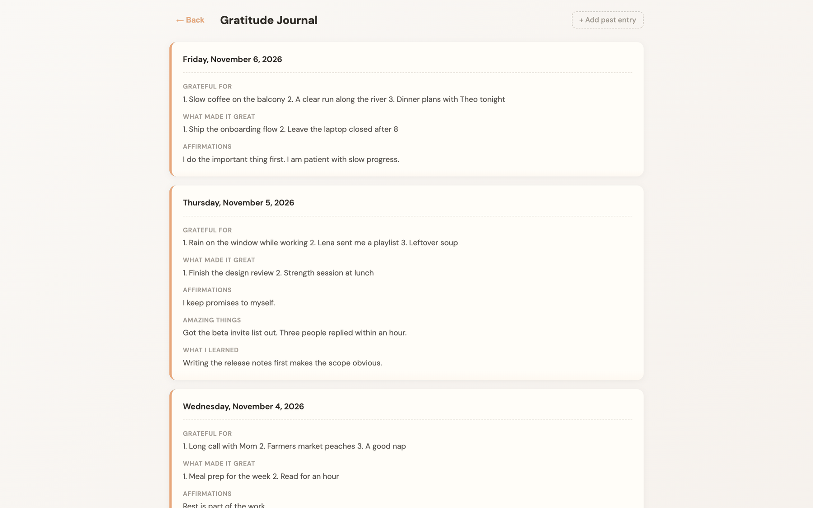
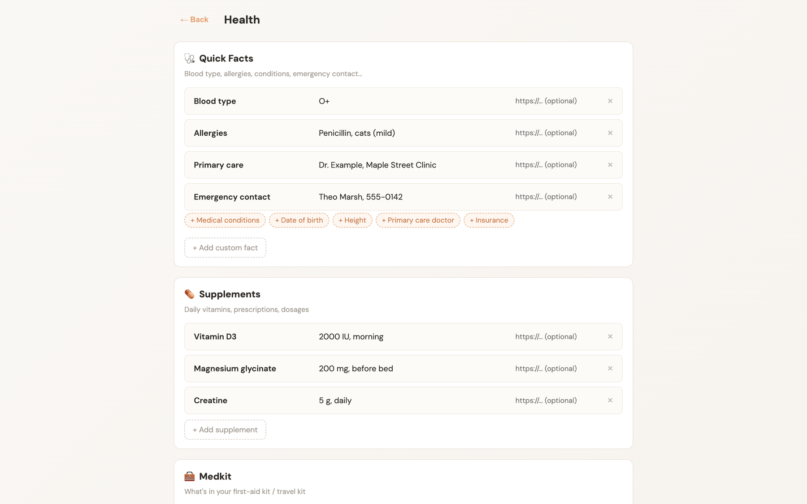
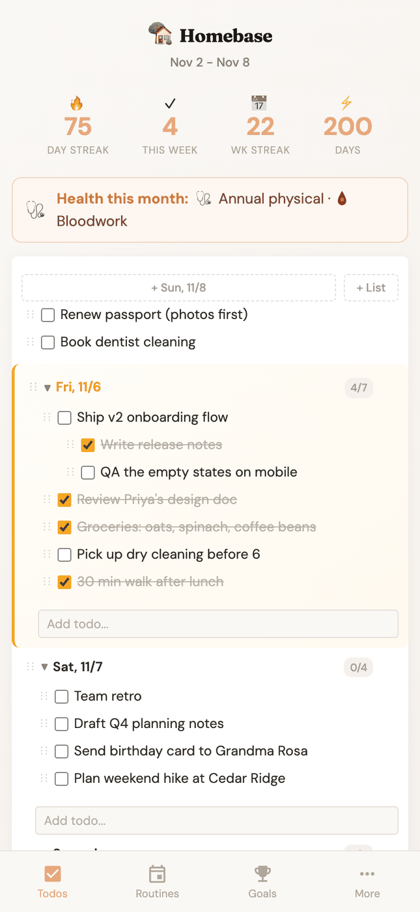

# Homebase

One place for your goals, habits, to-dos, and reflections.



<p>
  
  
</p>
<p align="center">
  
</p>

<sub>Screenshots use the built-in sample mode. All names and data are made up.</sub>

## Features

- **To-dos** grouped into dated lists, with nesting, bullets, toggles, drag to reorder, and undo
- **Routines** with weekly targets, daily check-offs, and streaks
- **Goals** for the quarter, the year, and life, with subtasks
- **Gratitude journal** with morning and evening prompts
- **Monthly reflections** that rate each area of life and keep notes
- **Friends** sorted into tiers, with last-contact tracking
- **Health** page for quick facts, supplements, a medkit list, and recurring tests by month
- **Reading notes** and a "cookie jar" of past wins
- **AI chat** that uses your own Anthropic API key (set in Settings)
- Installable as a PWA, with a mobile layout

## Stack

React 18, TypeScript, Vite. Supabase for Postgres and Google sign-in. No other backend.

## Running it

You need Node 18+, Yarn, and your own Supabase project.

1. **Install**

   ```sh
   yarn
   ```

2. **Set up Supabase**

   In the Supabase SQL editor, run, in order:

   - `supabase-schema.sql` (the base tables)
   - `sql-migration-1-add-user-id.sql` (adds `user_id` and per-user RLS policies)
   - everything in `supabase/migrations/`, oldest first

   Then turn on the Google provider under Authentication → Providers and add your local and deployed URLs to the redirect allow list.

   Heads up: the checked-in SQL doesn't create every table and column the app uses yet. `quick_notes`, `user_settings`, `monthly_reflections`, `analytics_events`, and `finances` are missing, along with a few columns (routine streak fields, `todos.completed_at`, `sections.parent_id`). `src/db.ts` shows what each one needs.

3. **Environment**

   Create `.env.local`:

   ```sh
   VITE_SUPABASE_URL=https://your-project.supabase.co
   VITE_SUPABASE_ANON_KEY=your-anon-key
   ```

   Set these. Without them, `src/supabase.ts` falls back to the original author's project, where you won't be able to read anything anyway.

4. **Run**

   ```sh
   yarn dev
   ```

   `yarn build` makes a production build in `dist/`.

## Sample mode

To see the app without Supabase or signing in, start the dev server in sample mode:

```sh
VITE_SAMPLE=1 yarn dev
```

or open any dev URL with `?sample`, like `http://localhost:5173/?sample`.

Sample mode swaps the Supabase client for an in-memory one loaded with fictional data (`src/sample/`). Nothing goes over the network. Edits work while the tab is open and are gone on reload. It only works in dev, so production builds never enter it.

## Data and privacy

Each user's data lives in Supabase. Every row has a `user_id`, and row-level security policies only let a signed-in user read and write their own rows. The anon key in the client is public by design. RLS is what keeps data separate.

The `supabase/legacy/` folder holds one-off scripts from the move to Supabase and multi-user auth. You don't need them for a new setup.
